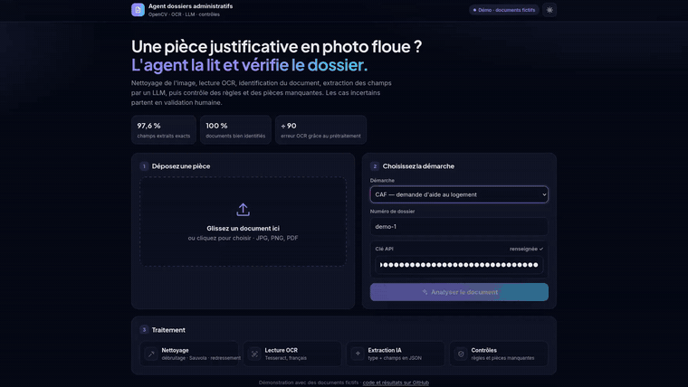
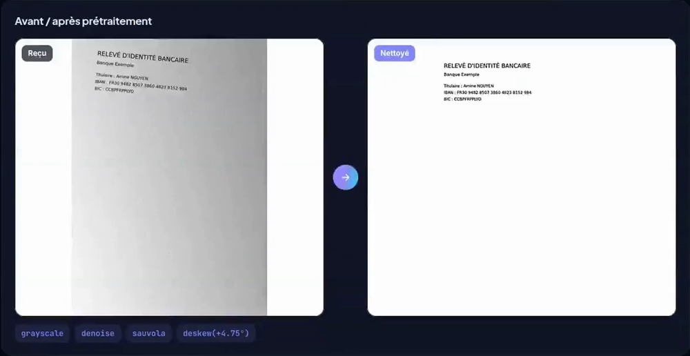
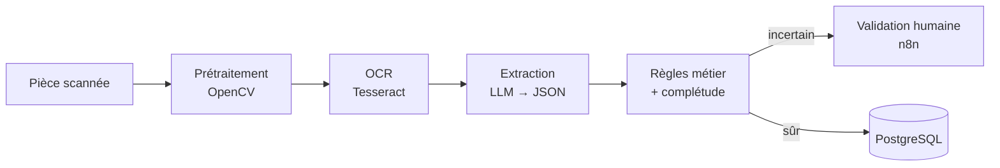
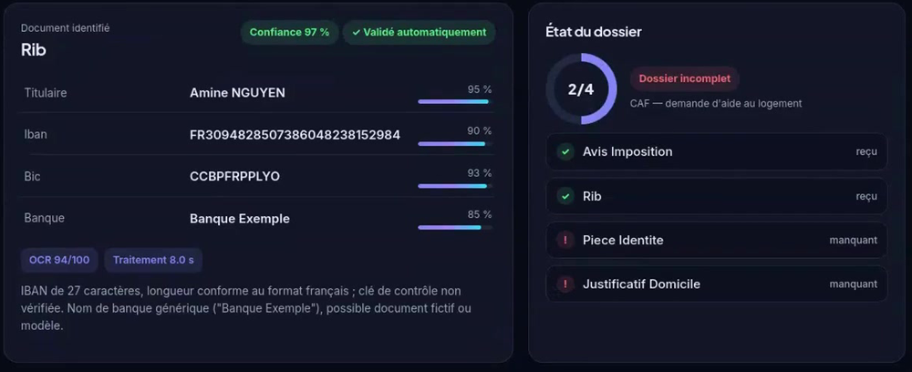

# Agent IA de traitement de dossiers administratifs

Un usager dépose une pièce justificative (avis d'imposition, justificatif de domicile, RIB…), souvent prise en photo floue. L'agent nettoie l'image, la lit par OCR, reconnaît le type de document, extrait les champs et vérifie si le dossier est complet. Quand il n'est pas sûr de lui, le document part en validation humaine.



## Résultats

Mesures faites sur 40 documents de test annotés, générés pour l'occasion (aucune donnée personnelle réelle) :

| Mesure | Résultat |
|---|---|
| Documents correctement identifiés | 100 % |
| Champs extraits exacts | 97,6 % |
| Documents envoyés en validation humaine | 10 % |
| Taux d'erreur OCR (CER), sans puis avec prétraitement | 0,625 puis 0,007, soit environ 90 fois moins |

D'après l'étude d'ablation, ce gain vient surtout du débruitage et de la binarisation locale de Sauvola, et non du redressement ni du modèle d'IA.



## Fonctionnement



Le prétraitement enchaîne un débruitage NL-means, une binarisation de Sauvola et un redressement par profil de projection. Le LLM (Claude) renvoie ensuite le type de document et ses champs en JSON, avec une confiance pour chaque champ.

Les décisions ne sont pas confiées au modèle : des règles en Python, couvertes par des tests, vérifient si une pièce est expirée, si un justificatif a plus de 3 mois, si la clé IBAN est valide, si les noms concordent entre les pièces et quelles pièces manquent pour la démarche choisie.



## Lancer le projet

```bash
cp .env.example .env          # renseigner ANTHROPIC_API_KEY
docker compose up --build     # ou sans Docker : voir docs/DETAILS.md
```

L'interface de démonstration est ensuite sur http://localhost:8000/demo.

Pour refaire l'évaluation : `python eval/generate_synthetic.py --n 40`, puis `python eval/evaluate.py --mode both`.

## Technologies

Python, OpenCV, Tesseract, FastAPI, API Claude, n8n, PostgreSQL et Docker.

## Limites

Le jeu de test est synthétique : il faudra confirmer ces chiffres sur de vrais scans anonymisés. Les listes de pièces par démarche sont simplifiées. Un usage réel demanderait aussi un modèle hébergé en France et une analyse RGPD.

La configuration détaillée et le dépannage sont dans [docs/DETAILS.md](docs/DETAILS.md).

Projet de Chems Eddine Adel Kebaily, étudiant en Master 1 Traitement du signal et des images à l'ULCO. [Portfolio](https://chemseddine-kebaily.netlify.app), [LinkedIn](https://www.linkedin.com/in/chemseddineadel-keb).
