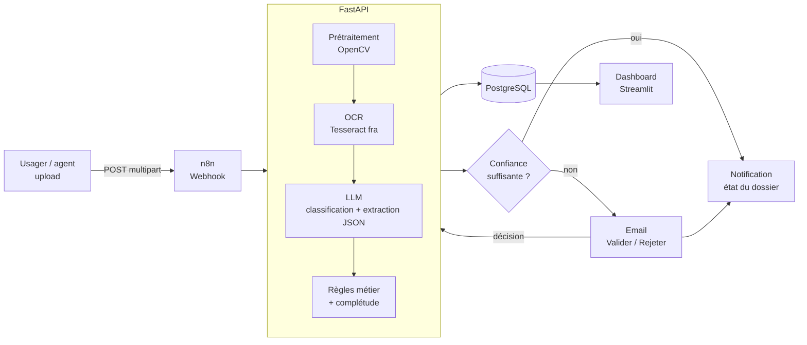

# Agent IA de traitement de dossiers administratifs

Un usager ou un agent d'accueil (CAF, CROUS, mairie, préfecture) dépose des pièces scannées ou photographiées. Le système :

1. **nettoie l'image** (débruitage, binarisation de Sauvola, redressement) ;
2. **lit le document** par OCR (Tesseract, modèle français) ;
3. **identifie le type de pièce** et **extrait les champs** en JSON structuré (LLM) ;
4. **contrôle les règles métier** de façon déterministe : pièce expirée, justificatif de plus de 3 mois, clé IBAN, cohérence des noms entre pièces ;
5. **vérifie la complétude du dossier** par rapport à la liste de pièces de la démarche et liste ce qui manque ;
6. **envoie les cas incertains en validation humaine** (email avec boutons Valider / Rejeter) ;
7. affiche dossiers, file de validation et métriques dans un **tableau de bord**.

> Le LLM extrait, les règles décident. Les contrôles métier sont en Python testable, pas dans un prompt. Un agent peut donc toujours savoir pourquoi un dossier a été bloqué.

## Architecture



| Composant | Rôle | Dossier |
|---|---|---|
| n8n | Orchestration : réception, appel API, validation humaine, notifications | `n8n/workflow.json` |
| FastAPI | Prétraitement, OCR, appel LLM, règles, persistance | `api/app/` |
| Config YAML | Types de documents, champs obligatoires, pièces par démarche | `config/` |
| PostgreSQL | Dossiers, documents, décisions de revue | `db/init.sql` |
| Streamlit | Suivi des dossiers et métriques | `dashboard/` |
| Évaluation | Jeu de test synthétique annoté et calcul des scores | `eval/` |

## Prétraitement d'image

Une photo de document prise au téléphone pose quatre problèmes : rotation, éclairage non uniforme, bruit et compression JPEG. Le pipeline (`api/app/preprocessing.py`) :

| Étape | Méthode | Pourquoi |
|---|---|---|
| Débruitage | Non-local means (`fastNlMeansDenoising`) | Conserve mieux les contours des caractères qu'un filtre gaussien ou médian |
| Binarisation | **Sauvola** : `T = m · (1 + k · (s/R − 1))`, moyenne et écart-type locaux calculés par box filter | Seuil local robuste aux ombres, là où Otsu (seuil global) noircit la zone sombre |
| Nettoyage | Suppression des composantes connexes < 12 px | Enlève le bruit « sel » résiduel |
| Redressement | Recherche de l'angle maximisant la variance du **profil de projection** horizontal (recherche grossière puis fine) | Les lignes de texte alignées donnent des pics nets |

L'ordre compte. Une première version estimait l'angle sur un masque d'Otsu et appliquait CLAHE avant Sauvola. Sur les photos mal éclairées, l'angle trouvé était faux (16° au lieu de 2°) et le fond devenait un bruit dense. Estimer l'angle **après** la binarisation locale a corrigé les deux problèmes. L'ablation ci-dessous mesure l'effet de chaque étape.

## Démarrage rapide

```bash
cp .env.example .env            # renseigner ANTHROPIC_API_KEY
docker compose up --build
```

- API : http://localhost:8000/docs
- n8n : http://localhost:5678 → *Import from file* → `n8n/workflow.json`, puis configurer les identifiants Gmail et remplacer `agent@example.fr`
- Dashboard : http://localhost:8501

Envoyer un document :

```bash
curl -X POST http://localhost:5678/webhook/dossier-upload \
  -F "file=@mon_avis.pdf" -F "dossier_id=D-2026-001" -F "dossier_type=caf_aide_logement"
```

Appeler l'API directement, sans n8n :

```bash
curl -X POST http://localhost:8000/documents \
  -F "file=@rib.jpg" -F "dossier_id=D-2026-001" -F "dossier_type=caf_aide_logement"
curl http://localhost:8000/dossiers/D-2026-001
```

Voir le résultat du prétraitement seul (utile pour la démo) :

```bash
curl -X POST http://localhost:8000/preprocess -F "file=@photo.jpg" -o propre.png
```

## Évaluation

Il n'y a **aucune donnée personnelle réelle** dans le dépôt. Le jeu de test est synthétique : les documents sont générés avec des identités aléatoires, puis dégradés comme une mauvaise photo (rotation jusqu'à ±8°, dégradé d'éclairage, flou, bruit gaussien, compression JPEG), avec un niveau de dégradation tiré entre 0 et 1.

```bash
pip install -r api/requirements-dev.txt          # + tesseract-ocr et tesseract-ocr-fra
python eval/generate_synthetic.py --n 60 --out eval/dataset

# Ablation du prétraitement (gratuit, sans LLM) : taux d'erreur caractère (CER)
python eval/evaluate.py --mode ocr

# Bout en bout : précision de classification, exact match et F1 par champ, taux de revue humaine
python eval/evaluate.py --mode full
```

Les résultats sont écrits dans `eval/results/report.md` et `metrics.json`, et affichés dans le dashboard.

### Résultats

OCR seul, 24 documents synthétiques dégradés :

| Configuration | CER |
|---|---|
| Image brute (Tesseract seul) | 0.707 |
| Redressement seul | 0.709 |
| Redressement + Sauvola | 0.248 |
| **Pipeline complet** (NL-means + Sauvola + nettoyage + redressement) | **0.006** |

Sur ces images, l'erreur vient surtout du bruit et de l'éclairage, pas de la rotation : le redressement seul ne change rien. Le bruit synthétique est volontairement fort (σ jusqu'à 25), ce qui donne beaucoup de poids au débruitage. Ces chiffres doivent être confirmés sur des scans réels.

Extraction de bout en bout : *à compléter après `python eval/evaluate.py --mode full`.*

### Limites

- Un jeu synthétique est plus propre que des scans réels (pas de tampons, de tableaux ni d'écriture manuscrite). L'étape suivante est un petit jeu réel anonymisé.
- Les listes de pièces dans `config/dossiers.yaml` sont simplifiées. Elles ne reproduisent pas les exigences officielles de chaque organisme.
- Un LLM hébergé reçoit le texte des pièces. Pour un déploiement réel, il faudrait un modèle hébergé en France ou en interne, une analyse d'impact RGPD (AIPD) et une durée de conservation définie.

## Tests

```bash
pytest     # prétraitement (redressement, Sauvola), règles métier, API avec LLM simulé
```

## Configuration

| Variable | Défaut | Rôle |
|---|---|---|
| `ANTHROPIC_API_KEY` | — | Clé API pour l'extraction |
| `LLM_MODEL` | `claude-opus-5-5` | Modèle utilisé |
| `LLM_EFFORT` | `low` | Effort de raisonnement (`low` suffit pour de l'extraction) |
| `MIN_LLM_CONFIDENCE` | `0.80` | En dessous, revue humaine |
| `MIN_OCR_CONFIDENCE` | `60` | Confiance Tesseract moyenne minimale (0-100) |
| `DATABASE_URL` | — | PostgreSQL ; stockage en mémoire si absent |

Pour ajouter un type de pièce ou une démarche, il suffit de modifier les fichiers YAML de `config/`. Aucun changement de code n'est nécessaire.

## Pistes d'amélioration

- Déclencheur par email (pièces jointes) en plus du webhook
- Validation par Telegram ou par un formulaire n8n avec correction des champs
- Détection et redressement de perspective (contour de la feuille, homographie)
- OCR par modèle de vision en repli quand la confiance Tesseract est faible
- Détection de falsification simple (incohérences de police, métadonnées PDF)

## Licence

MIT
