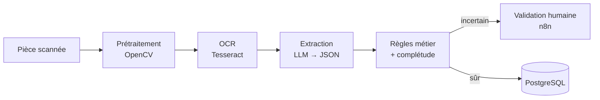

# Agent IA de traitement de dossiers administratifs

Un usager dépose une pièce justificative (avis d'imposition, justificatif de domicile, RIB…), souvent en photo floue. L'agent **nettoie l'image, la lit, identifie le document, extrait les champs et vérifie si le dossier est complet**. Les cas incertains partent en validation humaine.


## Résultats

Mesurés sur 40 documents de test annotés (générés, sans donnée personnelle réelle) :

| | |
|---|---|
| Documents correctement identifiés | **100 %** |
| Champs extraits exacts | **97,6 %** |
| Documents envoyés en validation humaine | **10 %** |
| Erreur OCR (CER) sans → avec prétraitement | **0,625 → 0,007** (÷ 90) |

Le gain vient surtout du **débruitage et de la binarisation locale (Sauvola)**, pas du redressement ni du modèle d'IA.


## Fonctionnement



- **Prétraitement** : débruitage NL-means, binarisation de Sauvola, redressement par profil de projection
- **Extraction** : le LLM (Claude) renvoie le type de document et les champs en JSON, avec une confiance par champ
- **Règles en Python** (testables) : pièce expirée, justificatif de plus de 3 mois, clé IBAN, cohérence des noms, pièces manquantes par démarche

## Lancer le projet

```bash
cp .env.example .env          # renseigner ANTHROPIC_API_KEY
docker compose up --build     # ou sans Docker : voir docs/DETAILS.md
```

Puis ouvrir **http://localhost:8000/demo**.

Évaluer : `python eval/generate_synthetic.py --n 40` puis `python eval/evaluate.py --mode both`.

## Stack

Python · OpenCV · Tesseract · FastAPI · Claude API · n8n · PostgreSQL · Docker

## Limites

Jeu de test synthétique : à confirmer sur de vrais scans anonymisés. Listes de pièces simplifiées. Un usage réel demanderait un modèle hébergé en France et une analyse RGPD.

---

📄 Détails techniques, configuration et dépannage : [docs/DETAILS.md](docs/DETAILS.md)

**Chems Eddine Adel Kebaily** · Master 1 Traitement du signal et des images, ULCO · [Portfolio](https://chemseddine-kebaily.netlify.app) · [LinkedIn](https://www.linkedin.com/in/chemseddineadel-keb)
